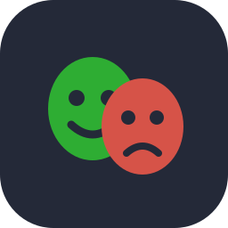
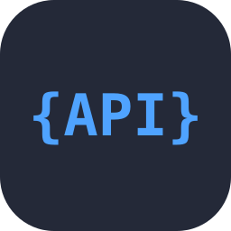
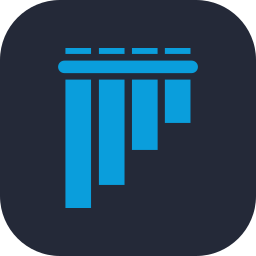

## Sobre mim

Trabalho com automação na ASTER Segurança. Meu dia a dia é pegar uma tarefa que alguém faz na mão toda semana, como copiar dado de um sistema para outro, montar relatório ou ficar cobrando prazo da equipe, e transformar isso num fluxo que roda sozinho.

A maior parte eu faço em n8n e Power Automate. Quando a ferramenta não dá conta, como nos robôs que baixam os relatórios da FullTrack e da Findme, eu parto para Python.

Quero seguir para backend. Integrando sistemas eu já tive que lidar com evento chegando duplicado, API fora do ar e dado vindo num formato diferente do esperado, e é justamente essa parte que eu mais gosto. O próximo passo é construir os serviços, e não só ligar um no outro.

Os fluxos publicados aqui são os que eu uso no trabalho. Antes de subir, removo credenciais, IDs e dados internos.

## Projetos

**Backend**

| Projeto | O que faz | Stack |
|---|---|---|
| [Gear Sync API](https://github.com/TheMessengerTM/Gear-Sync-API) | Puxa condomínios, unidades e moradores do sistema de controle de acesso GEAR, grava no PostgreSQL sem duplicar e expõe tudo numa API própria. Vem com servidor falso para rodar sem credencial, testes e CI. |     |

**n8n**

| Projeto | O que faz | Stack |
|---|---|---|
| [Alert Automation](https://github.com/TheMessengerTM/Alert-Automation) | Manda os alertas de telemetria da Cobli para a central de monitoramento (SIGMA) quase em tempo real. Usa Redis para não repetir alerta e reenvia quando a central não responde. |    |
| [Customer Closing Automation](https://github.com/TheMessengerTM/Customer-Closing-Automation) | O processo de encerramento de contrato de cliente, dividido em 11 fluxos. Começa num e-mail, registra no Microsoft Lists, dá prazo para o Comercial tentar reverter e aciona as equipes por enquete no WhatsApp. |     |
| [Reminder Automation](https://github.com/TheMessengerTM/Reminder-Automation) | Toda semana manda no grupo da equipe quais manutenções da frota já venceram e quais estão perto de vencer. |    |

**Power Automate**

| Projeto | O que faz | Stack |
|---|---|---|
| [Offboarding Report Automation](https://github.com/TheMessengerTM/Offboarding-Report-Automation) | Relatórios de desligamento, semanais e mensal. Sai uma prévia para a equipe conferir e, três horas depois, a versão corrigida que vai para a diretoria. |    |
| [Job Openings Automation](https://github.com/TheMessengerTM/Job-Openings-Automation) | Relatório semanal de quem foi admitido em cada área e um aviso para quem esqueceu de preencher a data de conclusão da vaga. |    |
| [Fleet Status Automation](https://github.com/TheMessengerTM/Fleet-Status-Automation) | Avisa os gestores por e-mail quando um veículo da frota muda de base, vai para a manutenção ou é emprestado a outro posto. Só dispara quando o posto muda, não a cada edição na lista. |    |

**Automação**

| Projeto | O que faz | Stack |
|---|---|---|
| [FullTrack Report Automation](https://github.com/TheMessengerTM/Fulltrack-Report-Automation) | Robô que entra na FullTrack todo dia, gera os relatórios do dia anterior e salva os CSVs organizados por ano, cliente, mês e tipo. |   |
| [Findme Report Automation](https://github.com/TheMessengerTM/Findme-Report-Automation) | A mesma ideia em outra plataforma: entra na Findme, baixa as planilhas de check-list e comentários de cada viatura de ronda e guarda tudo por ano, mês e posto. |    |

## Ferramentas

<table>
<tr><td><b>Automação</b></td><td>

</td></tr>
<tr><td><b>Linguagens</b></td><td>

</td></tr>
<tr><td><b>Integrações e dados</b></td><td>

</td></tr>
<tr><td><b>Backend</b></td><td>

</td></tr>
<tr><td><b>Outras</b></td><td>

</td></tr>
</table>

## Estudos

Do curso de Python que fiz:

- [Atividades de Python](https://github.com/TheMessengerTM/Araujotrader-Repositorio_Base_GuilhermeHenrique): exercícios de fundamentos, consumo de API, Jupyter, banco de dados, Flask e PyAutoGUI.
- [Avaliação prática do Módulo II](https://github.com/TheMessengerTM/Avaliacao-Pratica-Modulo-ll): uma API de calculadora em Flask e um CRUD em SQLite.
